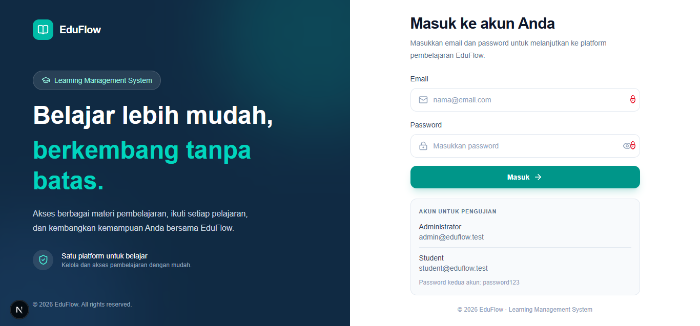
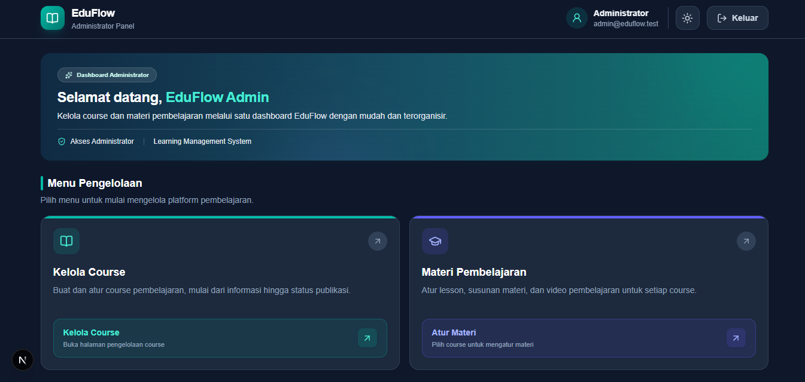
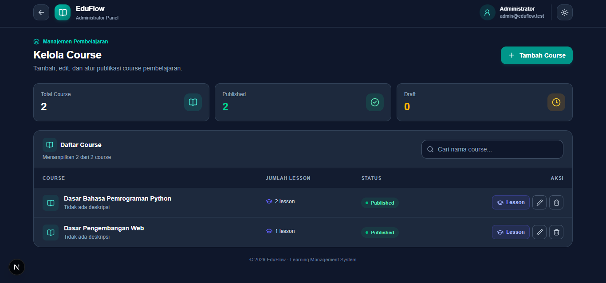
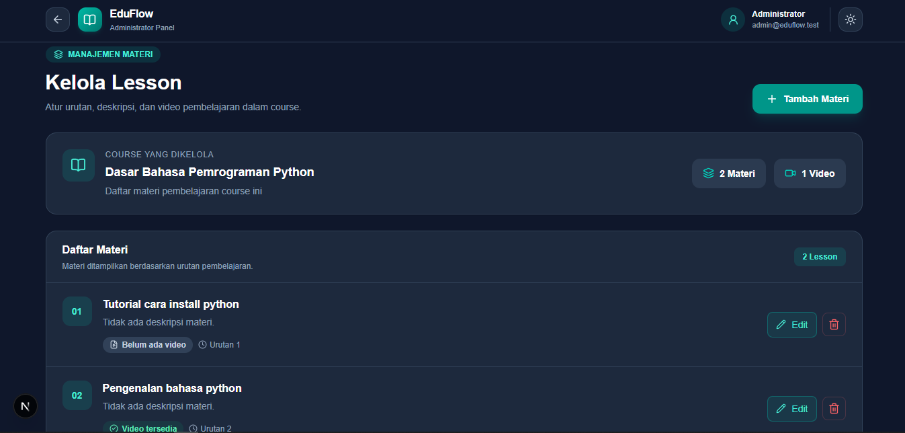
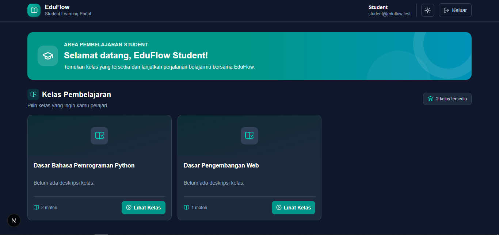
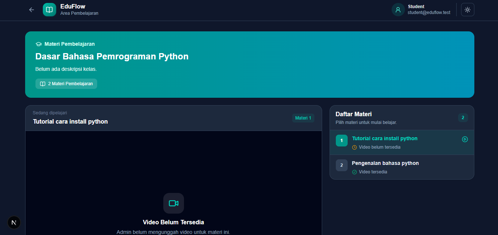

# 🎓 EduFlow – E-Learning Management System


EduFlow adalah aplikasi **E-Learning Management System** berbasis web untuk membantu pengelolaan kegiatan pembelajaran secara digital. Aplikasi ini menyediakan fitur pengelolaan course, lesson, dan student melalui dashboard admin, serta akses pembelajaran melalui akun student.

## ✨ Fitur Utama

### 🔐 Autentikasi
- Login pengguna berdasarkan hak akses.
- Pemisahan akses antara Admin dan Student.
- Halaman dan fitur disesuaikan dengan role pengguna.

### 👨‍💼 Admin
- Dashboard untuk melihat ringkasan informasi sistem.
- Mengelola data course.
- Mengelola lesson pada setiap course.
- Mengelola data student.
- Melihat detail kelas dan informasi pembelajaran.

### 🎓 Student
- Mengakses dashboard student.
- Melihat course dan kelas yang tersedia atau diikuti.
- Melihat detail kelas.
- Mengakses lesson sebagai materi pembelajaran.

## 🛠️ Teknologi

| Bagian | Teknologi |
|---|---|
| Frontend | Next.js, React, TypeScript |
| Styling | Tailwind CSS |
| Backend | Laravel 13 |
| Database | PostgreSQL |
| Authentication | Laravel Sanctum |
| File Storage | Cloudinary |
| Deployment | Vercel |

## 🔑 Akun Demo

EduFlow menyediakan dua jenis akun untuk mencoba aplikasi:

| Role | Fungsi |
|---|---|
| Admin | Mengakses dashboard admin dan mengelola course, lesson, serta student. |
| Student | Mengakses dashboard student dan melihat kelas serta materi pembelajaran. |

Gunakan akun Admin dan Student yang telah disediakan untuk demonstrasi aplikasi. Kredensial login dapat diperoleh secara terpisah dan tidak dicantumkan di repository publik.

**Alur penggunaan demo:**

1. Login menggunakan akun Admin untuk melihat dashboard dan mencoba fitur pengelolaan course, lesson, dan student.
2. Buat atau pastikan data course dan lesson tersedia.
3. Logout dari akun Admin.
4. Login menggunakan akun Student untuk melihat tampilan pembelajaran dari sisi student.
5. Buka detail kelas dan lihat materi lesson yang tersedia.

## 📸 Screenshots

### 🔐 Login



### 👨‍💼 Admin Dashboard



### 📚 Kelola Course



### 📝 Kelola Lesson



### 🎓 Student Dashboard



### 📖 Detail Kelas



## 📋 Requirements

Pastikan perangkat sudah memiliki:

- PHP.
- Composer.
- Node.js dan npm.
- PostgreSQL.
- Git.

## 🚀 Instalasi

### 1. Clone Repository

```bash
git clone https://github.com/herzbay/elearning-system.git
cd elearning-system
```

### 2. Setup Backend

Masuk ke direktori backend:

```bash
cd backend
```

Install dependency:

```bash
composer install
```

Salin file konfigurasi:

```bash
cp .env.example .env
```

Buat application key:

```bash
php artisan key:generate
```

### 3. Konfigurasi Backend

Buka file `backend/.env`, kemudian sesuaikan konfigurasi database PostgreSQL:

```env
APP_NAME=EduFlow
APP_ENV=local
APP_DEBUG=true
APP_URL=http://127.0.0.1:8000

DB_CONNECTION=pgsql
DB_HOST=127.0.0.1
DB_PORT=5432
DB_DATABASE=elearning
DB_USERNAME=postgres
DB_PASSWORD=your_password
CLOUDINARY_URL=your_cloudinary
```

Sesuaikan nama database, username, dan password dengan konfigurasi PostgreSQL lokal.

Konfigurasikan juga Cloudinary sesuai kredensial akun yang digunakan oleh aplikasi.

> Jangan membagikan file `.env` atau mengunggah kredensial database dan API key ke repository publik.

### 4. Migrasi Database

Pastikan database PostgreSQL sudah dibuat, kemudian jalankan:

```bash
php artisan migrate
```

Jika proyek menyediakan seeder dan ingin mengisi data awal:

```bash
php artisan db:seed
```

### 5. Jalankan Backend

```bash
php artisan serve
```

Backend berjalan secara default di:

`http://127.0.0.1:8000`

### 6. Setup Frontend

Buka terminal baru, kemudian masuk ke direktori frontend dari root repository:

```bash
cd frontend
```

Install dependency:

```bash
npm install
```

Buat file `.env.local` dan sesuaikan URL API backend dengan konfigurasi frontend:

```env
NEXT_PUBLIC_API_URL=http://127.0.0.1:8000/api
```

> Pastikan nama environment variable sesuai dengan yang digunakan pada konfigurasi API frontend.

### 7. Jalankan Frontend

```bash
npm run dev
```

Frontend dapat diakses melalui:

`http://localhost:3000`

## 📁 Struktur Repository

```text
elearning-system/
├── backend/                 # Laravel 
├── frontend/                # Next.js application
├── docs/
│   └── screenshots/         # Dokumentasi screenshot aplikasi
└── README.md
```

## 👨‍💻 Developer

**Bayu Herlambang**

- Portfolio: [bayuherlambang.my.id](https://bayuherlambang.my.id)